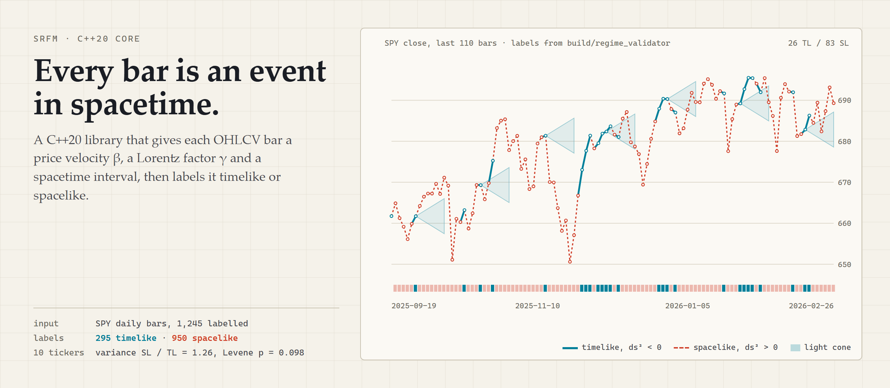

# Special Relativity in Financial Modeling

English | [简体中文](README.zh-CN.md) | [日本語](README.ja.md) | [한국어](README.ko.md)

[](LICENSE)

Labels each price bar an ordinary move or a jump.

7,977 lines of tests. Research code, not financial advice.

<picture>
  <source media="(prefers-color-scheme: dark)" srcset="assets/hero-dark.png">
  
</picture>

- Uses special relativity math on price, volume and momentum.
- Gives each bar a speed, a Lorentz factor and an interval.
- Ships a C++20 library and four command-line tools.
- Includes daily bars for ten sample tickers.

## Install

[Download for Windows (.zip)](https://gitlab.com/mattbusel/Special-Relativity-in-Financial-Modeling/-/releases/permalink/latest/downloads/srfm-windows-x64.zip). Unzip, double-click `demo.bat`.

## Use

```text
regime_validator --input validation/data/SPY_1m.csv --output spy_regime.csv --ticker SPY
```

[Site](https://special-relativity-finance.vercel.app/) · [Full reference](docs/REFERENCE.md) · [Paper](Paper%201.1.pdf)

License: MIT, see [LICENSE](LICENSE).

More: [docs/DETAILS.md](docs/DETAILS.md)
