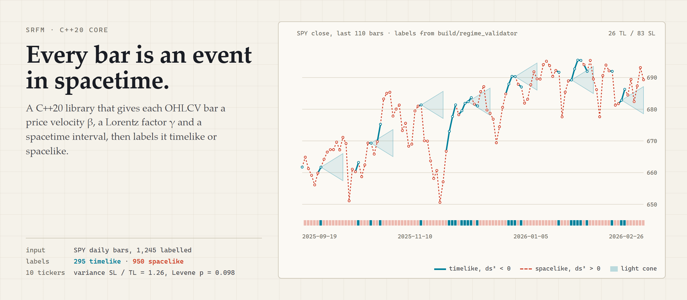
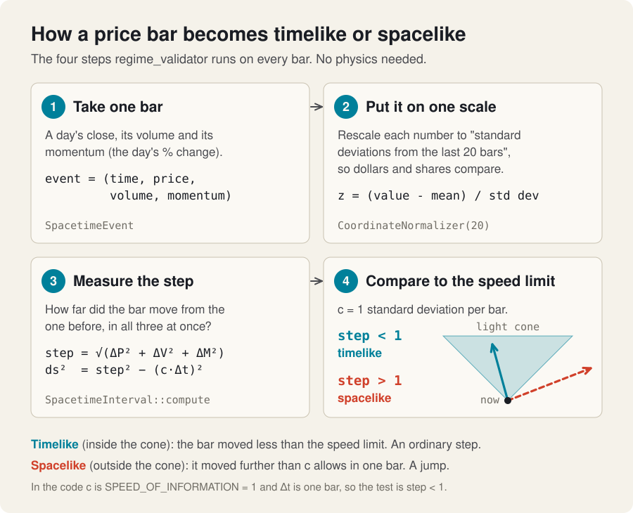
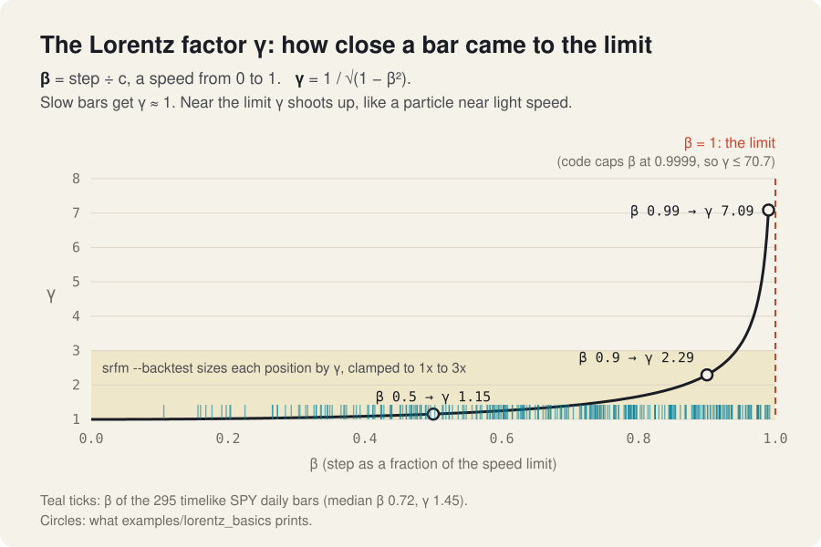
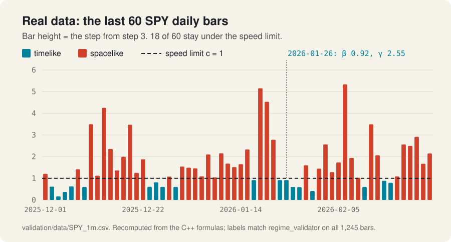

<picture>
  <source media="(prefers-color-scheme: dark)" srcset="assets/hero-dark.png">
  
</picture>

<p align="center">
  <a href="https://special-relativity-finance.vercel.app/"><b>Project site</b></a> &middot;
  <a href="#download">Download</a> &middot;
  <a href="#how-it-works">How it works</a> &middot;
  <a href="#examples">Examples</a> &middot;
  <a href="docs/REFERENCE.md">Full reference</a>
</p>

<p align="center">
  <a href="LICENSE"></a>
</p>

# Special Relativity in Financial Modeling

**A C++ library and command-line tools that borrow the maths of special relativity to label every stock or crypto price bar as an ordinary move (timelike) or a jump (spacelike).** Each bar gets a speed β against a market "speed limit", a Lorentz factor γ and a spacetime interval ds², computed from its price, volume and momentum.

For quants, students and curious traders who want to explore a physics analogy on real OHLCV data. **Research code, not financial advice:** it does not claim markets obey relativity, and nothing here is a tested trading strategy.

## Download

<a href="https://gitlab.com/mattbusel/Special-Relativity-in-Financial-Modeling/-/releases/permalink/latest/downloads/srfm-windows-x64.zip"><b>Download for Windows (.zip with .exe tools)</b></a>: unzip, double-click `demo.bat`.

| Platform | Get it |
|---|---|
| Windows x64 | [`srfm-windows-x64.zip`](https://gitlab.com/mattbusel/Special-Relativity-in-Financial-Modeling/-/releases/permalink/latest/downloads/srfm-windows-x64.zip): four `.exe` tools, the sample data and `demo.bat` |
| Linux x64 | [`srfm-linux-x64.tar.gz`](https://gitlab.com/mattbusel/Special-Relativity-in-Financial-Modeling/-/releases): `tar xzf srfm-linux-x64.tar.gz && ./srfm/demo.sh` |
| macOS, or the C++ library | Build from source with CMake: [three commands](docs/REFERENCE.md#build-from-source) |

The download holds `regime_validator` (labels bars), `backtest_runner`, `srfm` and `lorentz_basics`, plus ten sample tickers of daily bars (SPY, QQQ, AAPL, NVDA, BTC-USD and more). Every tool prints its options and an example with `--help`.

## How it works

<picture>
  <source media="(prefers-color-scheme: dark)" srcset="assets/how-it-works-dark.svg">
  
</picture>

**The spacetime interval** is the step measured against the speed limit: `ds² = step² − (c·Δt)²`. Negative means the bar stayed inside its light cone (timelike, an ordinary move); positive means it left it (spacelike, a jump). The code is `SpacetimeInterval::compute` and `MarketManifold::classify`.

<picture>
  <source media="(prefers-color-scheme: dark)" srcset="assets/lorentz-factor-dark.svg">
  
</picture>

**The Lorentz factor** γ = 1/√(1 − β²) turns a bar's speed into a multiplier: about 1 for calm bars, large near the limit. `srfm --backtest` uses it to size positions between 1x and 3x.

<picture>
  <source media="(prefers-color-scheme: dark)" srcset="assets/spy-last-60-dark.svg">
  
</picture>

These three figures come from [`scripts/figures/make_explainer.py`](scripts/figures/make_explainer.py), which recomputes the C++ formulas in plain Python on `validation/data/SPY_1m.csv` and refuses to draw unless every label matches `regime_validator`'s output (all 1,245 bars matched on 2026-09-28). The β shown in the figures is the step from step 3; the `beta` column that `regime_validator` writes comes from a separately normalised pass, so it can differ (it sits at the 0.9999 cap for most daily bars).

## Examples

Real output, run on 2026-09-28 from the Windows build, on the sample data that ships in the repo and in the download.

**1. Label every bar of a ticker** (what `demo.bat` runs first)

```text
> regime_validator --input validation/data/SPY_1m.csv --output spy_regime.csv --ticker SPY
[SPY] Loaded 1256 bars
[SPY] Classified 1245 bars
  TIMELIKE:  295  (23.6948%)
  SPACELIKE: 950  (76.3052%)
  LIGHTLIKE: 0  (0%)
[SPY] Output written to spy_regime.csv
```

`spy_regime.csv` has one row per bar: `ticker, bar_index, interval_type, next_bar_abs_return, next_bar_return, beta, geodesic_deviation`. Bitcoin looks similar: `--input validation/data/BTC_USD_1m.csv` labels 441 of 1,816 bars timelike and 1,375 spacelike.

**2. β, γ and the interval by hand** ([`examples/lorentz_basics.cpp`](examples/lorentz_basics.cpp))

```text
> lorentz_basics
beta = 0.00   gamma = 1.0000
beta = 0.50   gamma = 1.1547
beta = 0.90   gamma = 2.2942
beta = 0.99   gamma = 7.0888
dP = +0.4   ds2 = -0.84   Timelike
dP = +3.0   ds2 = +8.00   Spacelike
```

**3. Compare strategies on the labels** (`backtest_runner` reads the CSV from example 1)

```text
> backtest_runner --input spy_regime.csv --output-dir out --ticker SPY
  Strategy            Sharpe   Sortino      MDD    γ-IR
  RAW                   -0.3315  -0.4599  0.4554  -0.0209
  RELATIVISTIC          -0.3827  -0.5320  0.8610  -0.3710
  GEODESIC_DEV          0.2887  0.4238  0.1624  0.0182
[SPY] Backtest CSV written to out/SPY_backtest.csv
```

One ticker, in-sample, no costs: an illustration of what the tool reports, not evidence of an edge.

## Use it in 3 steps

1. Download the zip for your platform above (or [build from source](docs/REFERENCE.md#build-from-source)).
2. Run `demo.bat` (Windows) or `./demo.sh` (Linux) to label the bundled SPY bars.
3. Point `regime_validator --input` at your own CSV: any file with a header row and at least `close` and `volume` columns.

## Does the label mean anything?

The hypothesis: a spacelike bar is followed by more return variance than a timelike one. Pooled over the ten sample tickers, the variance after spacelike bars is about **1.26x** the variance after timelike bars. Bartlett's test calls that highly significant, but the fat-tail-robust Levene test does not (p = 0.098) and the effect size is small (Cohen's d = 0.034). Treat it as an open research question, not an edge. Full table, per-ticker chart and the commands to reproduce it: [docs/REFERENCE.md, "The empirical question"](docs/REFERENCE.md#the-empirical-question).

## Documentation

| Document | What is in it |
|---|---|
| [docs/REFERENCE.md](docs/REFERENCE.md) | Everything else: build from source, what gets built, the C++ API, the maths, tests, benchmarks, feature guides (Python, Rust), FAQ, paper |
| [ARCHITECTURE.md](ARCHITECTURE.md) | Module layout and data flow |
| [BUILD.md](BUILD.md) | Build options and platform notes |
| [RESULTS.md](RESULTS.md) | Committed validation results |
| [docs/troubleshooting.md](docs/troubleshooting.md) | Common build and run problems |
| [CHANGELOG.md](CHANGELOG.md) | Version history |
| [Paper 1.1.pdf](Paper%201.1.pdf) | The paper behind the idea |

## The SRFM project family

| Repository | What it is |
|---|---|
| **Special-Relativity-in-Financial-Modeling** (this repo) | C++20 core: β, γ, interval labels, Christoffel symbols and geodesic deviation on OHLCV bars, plus Python validation scripts |
| [srfm-lab](https://gitlab.com/mattbusel/srfm-lab) ([site](https://srfm-lab.vercel.app/)) | Multi-language research lab built on the idea: the black-hole signal, Monte Carlo backtests, a paper trader and an idea engine |
| [srfm-python](https://gitlab.com/mattbusel/srfm-python) | Pure-Python SDK: a pandas `df.srfm` accessor and a Polars wrapper for the Lorentz-factor pipeline |
| [srfm-paper-impl](https://gitlab.com/mattbusel/srfm-paper-impl) | The paper (PDF), scripts and a notebook that regenerate its figures, and a small Rust reference of the core formulas |

## License and citation

MIT, see [LICENSE](LICENSE).

```bibtex
@software{busel_srfm,
  author = {Busel, Matthew},
  title  = {Special Relativity in Financial Modeling},
  year   = {2025},
  url    = {https://gitlab.com/mattbusel/Special-Relativity-in-Financial-Modeling}
}
```
